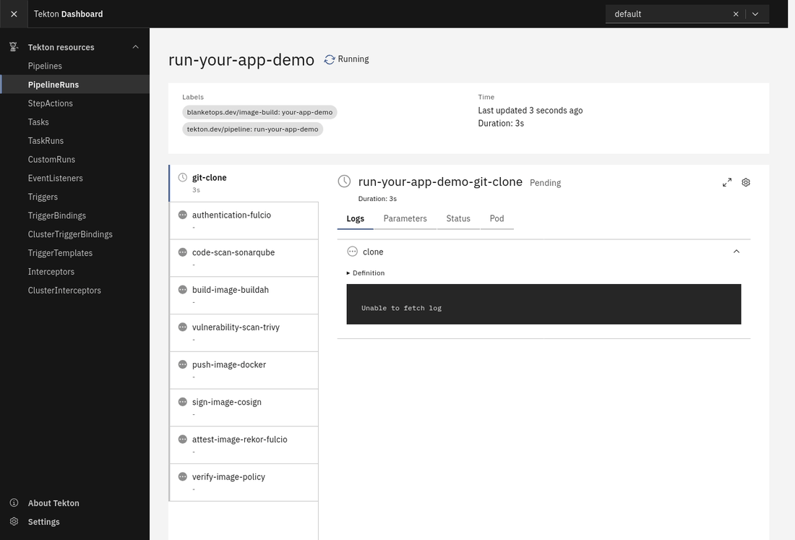

# secure-software-supply-chain

A Kubernetes operator that turns a git push into a container image that is built, scanned, signed, attested,
verified, and only then allowed to run. Built with Kubebuilder, driven by Tekton, secured by Sigstore.

> "Treat your pipeline as infrastructure, not a script."

---

## Demos

Short recordings of the real thing. The scripts behind them, and how to run them on your own cluster, are in
[`demo/`](demo/README.md).

- **[A build, live in the Tekton Dashboard.](demo/README.md#demo-5-a-build-live-in-the-tekton-dashboard)**
  Nine steps from clone to verified image, each turning green as it finishes.
- **[From a push to a running, verified image.](demo/README.md#demo-4-from-a-push-to-a-running-verified-image)**
  One `git push`; the cluster builds, signs, logs and admits the image on its own.
- **[Only what the pipeline built may run.](demo/README.md#demo-1-only-what-the-secure-software-supply-chain-built-may-run)**
  The pipeline's image is admitted; one signed by Tekton Chains alone and one signed by nobody are refused.
- **[No authorization, no identity, no certificate.](demo/README.md#demo-2-no-authorization-no-identity-no-certificate)**
  A build gets a signing identity only while it passes three access reviews; revoke one and it is gone within a second.
- **[What a build leaves behind.](demo/README.md#demo-3-what-a-build-leaves-behind)**
  The evidence for one build, read back from the registry and the transparency log.



---

## What it does

You declare a [`SupplyChain`](docs/usage.md#supplychain) for a repository and a
[`SupplyChainPolicy`](docs/concepts.md#enforcing-at-admission-supplychainpolicy) for what may run. From then on:

```
git push
  └── GitHub webhook ──► EventListener (Tekton Triggers)
        └── creates ──► ImageBuild
              └── owns ──► PipelineRun
                    1. git-clone                 fetch the source
                    2. authentication-fulcio     check the signing identity can reach Fulcio
                    3. code-scan-sonarqube       static analysis
                    4. build-image-buildah       build the image to a local archive
                    5. vulnerability-scan-trivy  scan the archive; any CRITICAL finding stops the build
                    6. push-image-docker         publish, and record the digest the registry serves
                    7. sign-image-cosign         keyless signature + authorization attestation
                    8. attest-image-rekor-fulcio hand the image to Tekton Chains for provenance
                    9. verify-image-policy       verify the published image the way admission will

kubectl apply (a workload)
  └── policy-controller ──► admits the image only if the SupplyChainPolicy is satisfied
```

What a successful build guarantees: no critical vulnerabilities (Trivy stops the build before the push); a
keyless signature from a [known identity that exists only while authorized](docs/concepts.md#an-identity-is-granted-not-default);
[two independent signatures](docs/concepts.md#two-tiers-of-proof) — the build's own and Tekton Chains' SLSA
provenance — both required at admission; a public witness (CT log proof and a Rekor entry); proof the build was
[authorized](docs/concepts.md#how-a-build-is-authorized); the signed digest is the one the registry serves; and a
durable [record of all of it](docs/concepts.md#what-a-build-leaves-behind).

---

## How it works, in brief

Three places hold the configuration, each with one job, and one more delivers the trigger:

| | Role | What it decides |
|---|---|---|
| Tekton Chains config | **Centre** | How the cluster signs: Fulcio, Rekor, the [identity provider](docs/concepts.md#signing-identity-kubernetes-or-spiffe), the provenance format |
| `SupplyChain` | **Authority** | Who may build and sign for a repository |
| `SupplyChainPolicy` | **Trust** | What is trusted at admission |
| [`GitHubWebhook`](docs/usage.md#githubwebhook) | **Ingress** | Which repository's pushes reach the cluster, and keeps the webhook registered on GitHub to start a build |

Every image carries proof from two independent identities, and admission requires all of it: the build's
ServiceAccount adds a signature and an attestation that the build was authorized; Tekton Chains adds a signature
and SLSA v1.0 provenance of the run. Signing is keyless — no long-lived keys exist in a build. With SPIFFE
identities, a build ServiceAccount can get a certificate only while it passes three SubjectAccessReviews.

[How it works](docs/concepts.md) explains each of these: [who decides what](docs/concepts.md#who-decides-what),
[how a build is authorized](docs/concepts.md#how-a-build-is-authorized),
[what admission requires](docs/concepts.md#enforcing-at-admission-supplychainpolicy) and
[what a build leaves behind](docs/concepts.md#what-a-build-leaves-behind).

---

## Resources

API group: `supplychain.blanketops.dev/v1alpha1`

| Kind | What it is |
|---|---|
| [`SupplyChain`](docs/usage.md#supplychain) | The pipeline definition for one repository. Owns the Tekton tasks, trigger stack, EventListener ingress and `supply-chain-runner` ServiceAccount. |
| [`SupplyChainPolicy`](docs/concepts.md#enforcing-at-admission-supplychainpolicy) | The admission side of a SupplyChain. Renders the policy-controller `TrustRoot` and `ClusterImagePolicies`. |
| [`GitHubWebhook`](docs/usage.md#githubwebhook) | Registers the push webhook on the GitHub repository and keeps it registered. |
| [`ImageBuild`](docs/usage.md#trigger-a-build-by-hand) | One execution of the pipeline. Owns the `PipelineRun` and tracks each step. |
| [`ImageSignature`](docs/concepts.md#how-a-build-is-authorized) | The record of the build's signature, read back from the registry and Rekor. |
| [`ImageBuildResult`](docs/concepts.md#what-a-build-leaves-behind) | The durable record of a build. Survives PipelineRun pruning. |

---

## Getting started

Installation takes seven phases, from an empty cluster to a first verified build:

```
0  Prerequisites      a cluster, tools, External Secrets Operator
1  Dependencies       supplychain install     cert-manager, Tekton, Sigstore, SPIRE, Vault, ingress, SonarQube
2  Operator           mage install deploy     the CRDs and the controller, built with ko
3  Credentials        supplychain secrets set   git, registry and GitHub credentials, kept in Vault
4  SonarQube          supplychain init-sonarqube
5  Resources          kubectl apply -k config/samples
6  Public webhook     Tailscale Funnel        so GitHub can reach the cluster
7  First build        an ImageBuild, then admission
```

[Installation](docs/installation.md) walks through each one — see especially
[storing the credentials](docs/installation.md#3-store-the-credentials) and
[making the webhook reachable](docs/installation.md#6-make-the-webhook-reachable-tailscale-funnel). Then
[Usage](docs/usage.md) covers [following a build](docs/usage.md#follow-a-build) and
[reading its results](docs/usage.md#read-the-results), and [Troubleshooting](docs/troubleshooting.md) covers what
goes wrong.

## Documentation

| | |
|---|---|
| [Installation](docs/installation.md) | The seven phases, including Vault, the credentials, and Tailscale Funnel |
| [How it works](docs/concepts.md) | Identity, authorization, the two tiers of proof, admission, and evidence |
| [Usage](docs/usage.md) | The resources you write, following a build, reading results, the CLI |
| [Troubleshooting](docs/troubleshooting.md) | What goes wrong and why |
| [Demos](demo/README.md) | The recordings above and how to make them again |

## Status

A working proof of concept, exercised end to end on a single-node kind cluster. Before relying on it:

- Credentials live in a Vault the installer runs, reaching builds through External Secrets; with SPIFFE the store
  logs in with a short-lived JWT-SVID. Vault's unseal key and root token are stored in the same cluster so it can
  restart unattended — fine for a demo, not for production. Any other
  [External Secrets provider](docs/installation.md#using-a-secret-store-of-your-own) can be used instead.
- Fulcio's and Rekor's signing keys are Kubernetes Secrets by default; `--key-residency vault` keeps them in Vault
  instead. See [Where the signing keys are kept](docs/installation.md#where-the-signing-keys-are-kept).
- Rekor, Fulcio, the CT log, Vault and SPIRE's OIDC discovery are reached over HTTPS with certificates from a
  private CA the installer creates. Tekton's own services and SonarQube are not.
- The SPIFFE signing identity is the one exercised end to end; under the Kubernetes identity, Tekton Chains' half
  of the proof has not been run.
- Branch names containing `/` cannot trigger a build yet.
- Admission reads signatures from the registry per policy and fails closed after ten seconds; on a slow registry
  link it can time out, and running the workload again succeeds.
- The Trivy step uses a ~1 GB pre-built scanner image; its first pull on a new node can outlast the step's time
  limit. See [Troubleshooting](docs/troubleshooting.md).

---

## Development

```bash
mage manifests generate   # after changing *_types.go or kubebuilder markers
mage test                 # unit and controller tests (envtest); writes JUnit XML to test-results/
mage lint                 # golangci-lint
mage testE2E              # creates its own kind cluster; allow 15-30 minutes; writes JUnit XML to test-results/
mage help                 # every target, and the settings they read (a bare `mage` does the same)
```

The build is a [magefile](https://magefile.org) in [`magefiles/`](magefiles/); the controller image is built with
[ko](https://ko.build) from [`.ko.yaml`](.ko.yaml). No Makefile, no Dockerfile. Without mage installed,
`go run mage.go <target>` does the same.

Both test targets write JUnit XML into `test-results/`, which [Allure](https://allurereport.org) ingests
(`allure generate test-results`) to build its report; CI uploads the same directory as an artifact.

The e2e suite deploys the operator and the real policy-controller, and checks that a `SupplyChainPolicy` is
rendered, that an unsigned image is rejected, that warn mode admits it, and that deleting the policy cleans up. It
has no Fulcio or Rekor, so the signed-image-admitted path is exercised by a real build, not the suite.

---

## Acknowledgements

[Tekton](https://tekton.dev) ·
[Tekton Triggers](https://tekton.dev/docs/triggers) ·
[Tekton Chains](https://tekton.dev/docs/chains) ·
[Sigstore](https://sigstore.dev) ·
[Fulcio](https://github.com/sigstore/fulcio) ·
[Rekor](https://github.com/sigstore/rekor) ·
[Policy Controller](https://github.com/sigstore/policy-controller) ·
[Buildah](https://buildah.io) ·
[Skopeo](https://github.com/containers/skopeo) ·
[Trivy](https://aquasecurity.github.io/trivy) ·
[SonarQube](https://www.sonarqube.org) ·
[Kubebuilder](https://book.kubebuilder.io) ·
[External Secrets Operator](https://external-secrets.io) ·
[Tailscale Funnel](https://tailscale.com/kb/1223/funnel)
